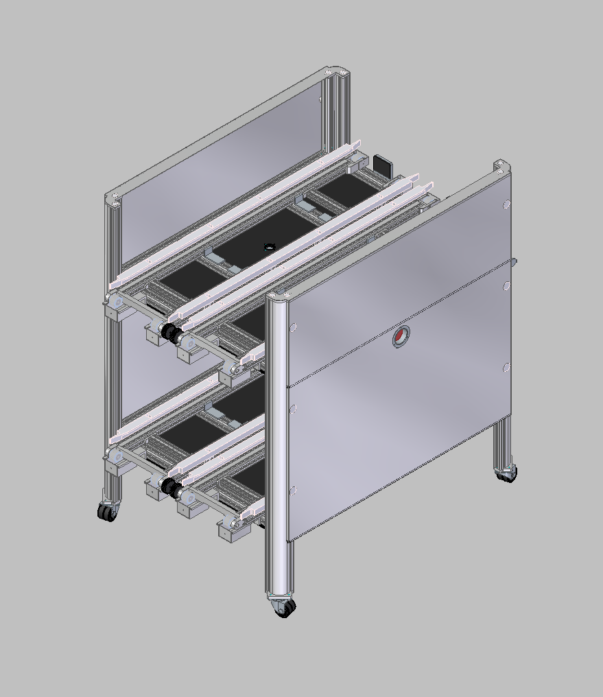

# 光伏货架车

> 便携式可滑动多层光伏组件展示与运输货架车（2025-003 项目）

## 目录结构
- `Body/` -存放主要内容
- `Note`  -存放零时想法

## 使用方法（包括INDEX）

### 项目简介
本项目为**光伏货架车**（Photovoltaic Shelf Cart），是一款专为光伏组件（太阳能板）设计的多层滑动式移动货架。采用铝型材框架 + 滑轨系统，可实现多层光伏板快速抽拉、展示、运输及存放，适用于光伏展会、工地临时存放、工厂调试、培训教学等场景。
### 项目效果图

*三层滑动式光伏货架车 - 实物渲染效果*
### 主要特点
- **三层独立滑动层**，每层可承载标准光伏组件
- 带万向脚轮，移动灵活，可锁定
- 铝合金型材框架，轻便且强度高
- 前置透明亚克力/钢化玻璃防护板
- 模块化设计，易拆装、易维护
- 适用于 182/210 大尺寸组件

## 保留内容

### 学习许可与权利保留

- 本项目允许个人、学校和研究者进行非商业性的学习、研究和引用。
- 未经著作权人书面许可，不得将项目内容用于商业开发、产品制造、商业服务、商业宣传、投标交付、毕业设计成品交付或再授权。
- 不得删除作者、来源、版本历史和第三方许可证声明，不得将本项目或其衍生成果宣称为与作者无关的原创项目。
- 软件源码适用 [PolyForm Noncommercial 1.0.0](https://polyformproject.org/licenses/noncommercial/1.0.0/)；机械模型、PCB、原理图、图片、文档、Unity 工程和其他非软件资料适用 [CC BY-NC-ND 4.0](https://creativecommons.org/licenses/by-nc-nd/4.0/)。
- SE、SW、STEP/STP 及其他三维模型仅允许个人或学校进行非商业学习、评审和研究；未经著作权人书面许可，不得用于加工、打样、制造、销售、量产、投标、产品交付、商业宣传、改作或再授权。
- 第三方组件、模板、元件库、外购件模型和工具仍受其原始许可证约束；本声明不扩大作者对第三方内容的权利。

商业使用、产品化、公司内部长期使用、转让或排他性授权需另行取得著作权人的书面许可。